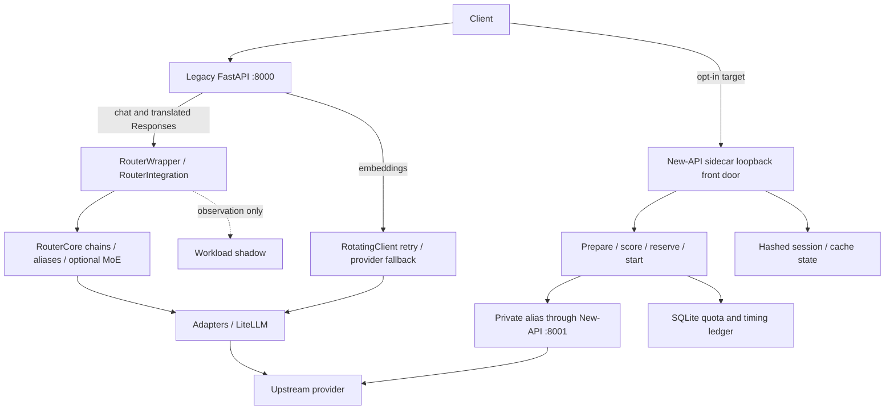

# Independent Project Audit

## 1. Snapshot, scope and conclusion

- Audit date: 2026-11-23.
- Repository: `/home/osees/CodingProjects/LLM-API-Key-Proxy` (not the outer repository).
- Branch: `main`.
- Audited HEAD: `5acacda126d6f9385f8ca17f1e4d032a93442f36`.
- Initial working tree: clean. Neither audit deliverable existed. Root `CLAUDE.md` and `STATE.md` were absent; `AGENTS.md`, `SPEC.md` and sidecar context were inspected.
- Historical reference: `/home/osees/beam-audit-reference.md`, read in full, unchanged. It describes the **same commit**, so disagreements below are corrections, not evidence of fixes made after Beam.
- Scope: tracked repository components, high-risk reachable call paths, sanitized configuration inventories, relevant plans, and safe local tests. This is a risk-led full-repository assessment, not a claim that every adapter, automation workflow or historical document was exhaustively reviewed.
- Decision informed: whether zero-spending operation and New-API cutover are trustworthy, and which changes should precede them. Roadmap: [DEVELOPMENT_ROADMAP.md](DEVELOPMENT_ROADMAP.md).

### Executive summary

**Not production-ready and not a trustworthy zero-monetary-spending boundary.** The sidecar has substantial, locally working implementation and unusually good provider-free fault tests. The legacy gateway has working routing machinery, but its checked-in free-only setting is disabled and its admission/accounting policies differ by path. The new stack still has concrete financial and privacy holes, despite its stronger design.

Immediate risks:

1. **P0: monetary eligibility is not universal.** Legacy virtual/MoE/embedding paths and sidecar credit/embedding paths can admit routes that violate the intended policy (F01-F02).
2. **P0: migration accepts `safe-coding` without preserving scrubbing.** It becomes ordinary coding traffic, not a privacy-protected route (F03).
3. **P0 if network-accessible: legacy auth is optional, and mounted status/model-management routers bypass it even when configured.** Error logging can retain headers and sensitive upstream text (F04-F05).
4. **P1: ungraded output is counted as semantic success.** The normal New-API server does not supply a grader or accept task-outcome feedback into its ledger (F06).
5. **P1: terminal-stream, retry, quota and crash-recovery gaps remain.** Several historical bugs are fixed, but those fixes do not establish end-to-end guarantees (F07-F09).

Local evidence: **403 sidecar tests passed; 50 selected legacy tests passed** under explicit isolation. Six additional in-memory defect reproductions succeeded. No actual provider request, completion, quota consumption, deployment or live service inspection occurred. Current VPS operation, billing settings and external New-API behavior remain unverified.

### Severity and evidence rubric

| Level | Meaning |
| --- | --- |
| P0 / critical | Possible monetary exposure, credential/privacy exposure or unsafe normal operation; block affected deployment/cutover. Reachability conditions are stated, not assumed. |
| P1 / high | Core reliability, semantic correctness, quota correctness or release-readiness blocker. |
| P2 / medium | Maintainability, observability, performance or bounded-state improvement. |
| P3 / later | Optional specialization/experimentation after safety and reliability. |

`Confirmed defect` means source behavior is established, sometimes also reproduced with synthetic inputs. It does not mean actual charges or compromise occurred. `Limitation` means a deliberately narrower contract. `Risk` requires a condition such as network exposure or stale upstream configuration. `Unknown` needs evidence unavailable within this audit.

## 2. Actual architecture and request flow

The merged direction is in `docs/ARCHITECTURE-DECISION-2026-11-22.md:9-37`: one brain, one transport, legacy rollback. Its references to pending branch work and dated live facts are not current execution proof.

| Component | Actual responsibility and implementation | Operational evidence |
| --- | --- | --- |
| `src/proxy_app/main.py` | FastAPI legacy surface; chat delegates to RouterWrapper/RouterIntegration/RouterCore; Responses translates to the same router; embeddings uses RotatingClient instead. | Code and deploy unit exist; docs report live `:8000`. Not observed live here. |
| `src/proxy_app/router_core.py`, `routing/`, `semantic_router.py` | Virtual chains, direct-model and alias resolution, legacy lexical/optional semantic routing, retries, metrics, cache affinity and optional smart-chain selection. | Reachable from chat; policy remains duplicated with sidecar. |
| `src/rotator_library/` | Credential rotation, provider plugins, auxiliary retry/fallback, usage, cooldown/concurrency, discovery and multiple telemetry stores. | Library implementation exists; individual provider availability not tested. |
| `workload-router/router_server.py` | Older standalone inspection/chat prototype using Deployment, HealthRegistry, RouterState, generic adapters and StallState. | Tests pass locally; docs describe an older loopback canary. Not the New-API Runtime. |
| `workload-router/newapi_server.py` | Intended front door: authenticated loopback HTTP server, compatibility shims, preparation, strict New-API preflight and quota-accounted Runtime. | Local HTTP/stub tests pass. Current deployment not established. |
| `workload-router/newapi_runtime.py`, `route_policy.py`, `quota_ledger.py` | Private-alias attempts, profile/step scoring, capability/context gates, shared-pool reservations, cooldown and outcome evidence. | Substantial implementation, not a complete agent orchestrator. |
| New-API, intended `:8001` | External transport binary; keys, channels, mapping, discovery/admin. | Not vendored runtime source. Repository has packaging and dated integration records, not a current install/config proof. |
| `src/proxy_app/workload_router_shadow.py` | Optional bounded, prompt-free observation; off by default; result discarded. | Not a bridge that makes sidecar authoritative (`router_wrapper.py:20-35,54-59`). |
| Optional `llm-gateway` Worker/rewriter | Sibling repository named by the architecture decision, not a directory in this checkout. | Cannot independently audit edge rewriting/pricing here. Do not describe it as a verified runtime dependency. |

Key paths:

- Legacy chat: `main.py:1106-1241` -> `router_wrapper.py:45-109` -> `router_integration.py:173-240` -> `router_core.py:3000-3480`. It does **not** bypass RouterCore. The normal chat adapters do not necessarily pass through RotatingClient's separate gates.
- Legacy embedding: `main.py:1245-1332` -> batcher or `client.aembedding()` -> `_execute_with_retry()` (`client.py:1134-1260,3106-3130`) -> provider-priority fallback, not RouterCore free-only admission.
- New-API: `Handler.do_POST` -> `prepare()` -> `Runtime.complete/open_stream` -> rank -> transactional reserve -> start -> one private-alias adapter attempt -> finish -> optional grade -> cache/session remember. Startup audits exact mappings, single-key channels and `RetryTimes=0` (`newapi_catalog.py:110-170,191-210`).
- Only the older `router_server.py` imports stall escalation. Its `select/route_plan` behavior is not identical to New-API profile scoring. Do not combine their feature lists as though one server implements both.

## 3. Implementation status and financial safety

### Financial taxonomy

The sidecar separates customer prices (`Route.money`) from notional promotional-credit tariffs (`credit_money`) and quota windows (`quota_ledger.py:125-245,388-398`). This is a useful foundation:

| Category | Intended interpretation | Current enforcement |
| --- | --- | --- |
| Actual monetary spending | Charges or debt; must always be zero. | Locally configured prices are not comprehensive financial proof; loopholes below. |
| Free quota | Requests/tokens in renewable or limited allowance. | Sidecar checks configured/learned windows transactionally. Legacy checked-in request chains supply no effective nested rate-limit fields. |
| Promotional credits | Scarce allowance, not money owed. | Separate tariffs exist, but `credit_based` also permits positive customer prices. Expiration/top-up/overage guarantees are not modeled. |
| Unknown classification/pricing | Must fail closed. | Normal sidecar capacity rejects `unknown`; legacy has permissive defaults and failed metadata/credit reads can become availability. |

No automatic top-up implementation was found in inspected routing/operator code. That is **not proof** that accounts, upstream services, external transports or automation cannot bill. Free-tier advertising, a `:free` suffix or zero locally configured price is insufficient without account-level no-overage/no-top-up assurance.

### Confirmed findings

#### F01 - P0: legacy financial policy is disabled and inconsistent

- `config/router_config.yaml:1` sets `free_only_mode: false`. `RouterCore.__init__` reads YAML with missing-key default false (`router_core.py:914-935`). `enhanced_proxy.py:439` logs the unrelated `FREE_ONLY_MODE` environment value, default true. This is not two equivalent authorities: **YAML controls this router**; the env log/documentation can mislead operators.
- Virtual candidates check their `free_tier_only` flag with default true, plus a forbidden list (`router_core.py:2285-2302`). The later normal filter checks enabled and a **non-empty** free-model list, not provider funding (`3224-3241`). An enabled non-forbidden paid/unknown provider with an absent/empty model list can therefore pass a virtual route even with free-only true.
- Direct references are more restrictive: `_is_provider_allowed_in_free_mode` rejects missing/false provider `free_tier` (`1338-1351`); the later model list still permits any model when empty. Thus alias recursion is **not automatically a paid-provider bypass**: it re-enters direct admission. Its real gap is incomplete model-level financial proof.
- MoE branches **before** the normal admission loop (`3175-3184`); experts and aggregator use `_get_candidates` and direct execution (`2599-2714`), skipping normal enabled/model-list/health filters. Checked-in virtual models currently have no `moe_mode`, so this is a latent but reachable configuration-driven defect, not a currently enabled ensemble.
- Embeddings bypass RouterCore altogether. RotatingClient's priority manager orders all available credentials without a monetary classification gate (`provider_priority_manager.py:226-276`). Asking for a paid credential/model or falling back to one is not prevented by RouterCore's setting.

Impact: enabling a YAML flag alone does not enforce zero spending across the surface. Actual charges require usable billable credentials/upstream behavior; neither was inspected. Tests called free-only largely assert configuration presence rather than dispatch denial (`tests/test_free_only_mode.py:15-166`).

#### F02 - P0: sidecar zero-money checks omit credit, cached-price and embedding cases

- `route_policy.score_route:87-90` rejects `paid`; zero input/output prices are required only for `unlimited`/`rate_limited`. A `credit_based` route with positive **customer** prices, finite balance and prices passes capacity and scoring. In-memory reproduction confirmed feasible selection.
- `Runtime.embed:635-664` excludes only `quota_type == "paid"`, then calls ledger reservation directly. A known `unlimited` embedding route with positive input price successfully reached the **stubbed** embedding transport under `free_only=True`.
- `Route.money:222-232` can use a positive `cached_input_price` even when ordinary input/output are zero; scoring does not validate that tariff as zero.
- Runtime construction validates boolean flags/budgets, not all route prices (`newapi_runtime.py:459-474`); `serve:667-715` audits channel identity but has no startup funding/zero-price catalog validation. The architecture's "priced route is a startup error" guardrail is not implemented.
- Unknown classes are **not** admitted on the normal path: `_capacity:346-348` rejects unknown quota type, and `_capacity:356-373` rejects unknown price, credit balance/tariff and missing finite-tier limits. This disproves Beam A6's end-to-end conclusion.

Impact: private aliases and strict retry audit are necessary but insufficient. Apply one zero-money invariant to startup **and every dispatch**, including auxiliaries and cached prices; do not just add a skip in the scorer. Existing paid-exclusion tests did not catch these cases.

#### F03 - P0 cutover blocker: `safe-coding` silently loses privacy semantics

`LEGACY_ALIASES` maps `safe-coding` to ordinary `auto-coding/implement` (`newapi_runtime.py:29-56,165-217`). Neither Work nor Route expresses required scrubbing/privacy capability; the normal path performs no PrivAiTe call. `workload-router/docs/newapi-v1-v2-roadmap.md:285` acknowledges this missing behavior, yet the server accepts and advertises the alias.

Impact: a user relying on the protected alias can send raw sensitive context to an ordinary provider after migration. Name acceptance is not semantic compatibility. Reject the alias until an independently tested protected route exists; do not repoint it upstream as a fallback.

## 4. Security, authentication and privacy

#### F04 - P0 for network use: incomplete legacy authentication and authorization

- `main.verify_api_key:785-792` deliberately allows access if `PROXY_API_KEY` is unset/empty; task outcomes mirror this (`outcomes_api.py:28-34`). CLI and checked-in deployment bind `0.0.0.0` (`main.py:43`; `deploy/llm-gateway.service:10`). Interactive setup may establish a key, but it is not an application-wide fail-closed guarantee.
- `main.py:761-764` mounts status, CLIProxyAPI and model routers without auth dependencies. `status_api.py:23-232`, `cliproxyapi_api.py:14-210` and `model_api.py:27-183` have no API-key checks. Model switching is a write endpoint; raw session keys are process-global and unbounded. These remain unauthenticated even if chat auth is enabled.
- No distinct admin role/tenant authorization exists on these routers. Status history has no meaningful upper hour bound and can expose operational diagnostics.
- Network exposure on today's VPS is **unknown**. Documents describe Tailscale/firewall/reverse-proxy controls; this audit did not verify them. A loopback-only, single-user service has a lower threat level, not an exemption from credential/log safety.

The New-API front door is significantly better: mandatory validated key, byte-based constant-time comparison, duplicate Authorization rejection, authenticated data endpoints, only root/health unauthenticated (`newapi_server.py:105-129,207-230,377-390`). It is loopback-only and has worker/body/socket bounds. It still has one shared client identity, not multi-user isolation.

#### F05 - P0/P1 conditional privacy risk: sensitive logs and unsafe auxiliary errors

- **Normal legacy error paths** retain raw exception text in logs (`router_core.py:1529-1535,1597-1600`; `router_integration.py:199,236,263`) and task telemetry stores truncated raw error text and caller task IDs/notes (`task_telemetry.py:28-60,101-175`; `main.py:1166,1175-1177`). Truncation is not redaction.
- `failure_logger.log_failure` stores request headers, response bodies and error chains (`src/rotator_library/failure_logger.py:147-220`); embedding/rotator failure callers supply request headers (`client.py:1649-1662,1711-1724`). A masked key field does not sanitize an Authorization header elsewhere in the same record.
- Legacy embedding errors echo `str(e)` for multiple status classes and generic errors (`main.py:1312-1332`). Status/CLIProxyAPI handlers likewise expose raw failures. Ordinary chat safe-error helpers do not cover these paths.
- `DetailedLogger.log_request/final_response` would store raw headers/body/reasoning (`detailed_logger.py:63-98,143-153`), **but no `DetailedLogger(...)` instantiation was found in `src/`**. Beam's assertion that the CLI logging flag definitely activates this logger on normal chat is unsupported. The reachable raw-error/header log risks above are stronger evidence.
- The New-API ledger/state avoid raw prompts and credentials. However, `provider_status._provider:87-102` exports upstream `error_message`; authenticated access does not make arbitrary text safe. Catalog refresh whitelists fields but persists provider-supplied names/metadata, not independently sanitized arbitrary strings (`newapi_catalog.py:282-310`).
- Hashing is not universal anonymization: `router_state.py:74-76` and ledger session hashing use unsalted SHA-256 (linkable/guessable identifiers). The older prototype logs raw session prefixes (`router_gate.py:45-63`; calls in `router_server.py:203,287`); legacy passive telemetry stores raw `agent_session` (`src/proxy_app/telemetry/logger.py:358-375`). Sidecar model-session state holds raw IDs in bounded memory, not SQLite.

Impact depends on local file permissions, log collection and service exposure. This is confirmed persistence capability, not a claim that real secrets were observed. No secrets or existing logs were read.

### Endpoint and resource boundaries

`newapi_runtime.validate_endpoint:75-86` rejects URL credentials, query/fragment and non-loopback cleartext; adapters/admin use no-redirect openers. These are useful safeguards, **not complete SSRF prevention**: arbitrary HTTPS/internal/DNS destinations remain possible for operator-supplied endpoints. The channel audit compares endpoint identity; Route only length-validates `channel_base_url` (`quota_ledger.py:195-200`), whereas `AdminClient.create_route` validates TLS. Pre-existing imported channel URLs therefore need explicit policy validation. No client-provided arbitrary endpoint path was found in the New-API handler.

Legacy OpenAI-compatible adapters accept `api_base` without equivalent validation and infer all listed models as tool-capable/free (`provider_adapter.py:140-180`). Request parsing on legacy chat is unbounded `await request.json()` (`main.py:1116-1119`); no application-wide body/concurrency/rate-abuse boundary was found on that path. New-API requests are limited to 1 MiB and 1-32 workers, but public-service per-user quotas/roles are absent.

## 5. Routing, context and agentic quality

#### F06 - P1: semantic learning confuses output delivery with task success

`QuotaLedger.evidence:510-528` counts `quality != 0` and successful status as positive evidence. `None != 0` is true. A completed, ungraded synthetic attempt increased alpha from 2 to 3; the reproduction checked the stored quality was still null.

`Runtime.complete:569-604` accepts an optional grader; `Handler.do_POST` calls it without one (`newapi_server.py:469,507`). Stream completion does not grade. The server exposes neither `/api/task-outcome` nor `/v1/router/outcome`; older prototype outcomes and legacy outcomes do **not** update this ledger. Five benchmark graders are deterministic JSON/tool comparisons (`newapi_benchmark.py:52-90`), not production task oracles.

Preserve `usable_completion:430-453`: nonstream reasoning-only/empty output and malformed function-call arguments are rejected. But any non-empty prose, wrong schema content or incorrect code can still be transport-successful. That is legitimate operational evidence, not task correctness. Quality grades influence scoring/Thompson sampling once present; currently unknown quality positively biases it. Stall detection is absent from the normal New-API path, and older detection compares exact actions (`stall_detector.py:14-21`) with ephemeral state (`router_server.py:85,189-195`).

Highest-value agentic work: correlated client-side test/tool outcomes, unknown-quality semantics, bounded normalized stall escalation, and valid streamed tool completion. No paid/model-based grading calls are needed for these steps.

#### F09 - P1: capability/context safety differs by entrypoint

- New-API chat preparation counts UTF-8 serialized payload bytes plus framing, including system/history/tools/schema and explicit/default output budget (`route_policy.py:142-156`; `newapi_runtime.py:165-217`). Unknown required tool/stream/schema/web support and context/output limits fail closed (`score_route:73-93`). Nontext/multimodal content is rejected. This is conservative and can substantially over-reject long agent requests; it is not an exact tokenizer.
- Legacy virtual context admission now includes tool schemas, tool-call arguments and explicit output budget (`router_core.py:2176-2213`). It is still a char/4 heuristic with 20% headroom, excludes images and response-format schemas, uses provider-wide caps/default 8192 rather than proven model limits, and does not include an absent/default output allowance. Direct/alias candidates bypass that virtual-context branch.
- Empty legacy capability sets return true (`router_core.py:415-441`), delegating rejection to adapters; the generic adapter itself declares tools/stream/free availability for all listed models. Unsupported requests can therefore consume attempts rather than fail before dispatch.
- The **older** sidecar server uses message-only char/4 and client `context_tokens` (`router_server.py:170-188,269-276`; `router_core.py:31-34`), not the New-API bound. Beam's tools/output undercount is real there, but should not be attributed to New-API chat.
- Sidecar embeddings estimate `len(text)//3+1`, do not use the conservative UTF-8 bound, and do not apply chat context/output/capability checks (`newapi_runtime.py:635-650`). Reported vector indexes/counts are validated only superficially, not against requested batch identity (`381-427`).
- `auto` classification is lexical and deterministic, based on latest user text and explicit step; actual selection defaults to stochastic top-N Thompson exploration (`Runtime.__init__:459-474`; `route_policy.py:117-139`). Exploration selects only feasible scorer candidates, not inherently capability-ineligible routes. Coding steps affect evidence, but there is no per-step quality floor or verified specialization gate beyond profile/capability metadata.
- Coding stickiness/cache are soft scoring hints (`newapi_runtime.py:481-504,532-542`), not a guarantee that a tool continuation stays on its model. The older replay calls `select`, not `route_plan` or New-API scoring (`trace_replay.py:60-81`), so it cannot validate current cache/ledger policy.

The project is suitable for text/tool-oriented routing experiments, not an end-to-end autonomous coding completion guarantee. Research/data-analysis get text/context/schema primitives, not verified specialization. Computer-use actions, image accounting, authorization and action safety are not implemented by this router; do not assume generic function tools provide them.

## 6. Retries, streaming and quota accounting

#### F07 - P1: terminal/output correctness remains incomplete

**Preserve the fixes:** legacy stream and alias loops no longer fail over after any yielded chunk (`router_core.py:2924-2999,3041-3110`). Sidecar primes until usable output before committing headers, records late errors as failure with conservative usage and never retries after returned output (`newapi_runtime.py:607-633,667-772`). Local tests exercise these behaviors.

Remaining confirmed issues:

- Legacy `_sse_wrap` emits error text as assistant content, then `finish_reason:"stop"` and `[DONE]` (`main.py:1160-1209`). Task telemetry records an error, but an SDK may see a normal completed response. This is still a terminal failure representation problem, not post-output failover.
- Sidecar accepts a non-empty streamed `tool_calls` list of objects as usable; it does not assemble and validate final name/arguments or require a valid finish reason before `[DONE]` (`newapi_runtime.py:716-751`). Synthetic `tool_calls:[{}]` followed by DONE was settled as success. Text plus DONE with no terminal finish is likewise sufficient. Nonstream malformed-tool validation is stronger.
- `usable_completion` does not treat `finish_reason:"length"` as unusable; `responses_object:337-363` and the text SSE shim can advertise a truncated completion as `completed`. Distinguish transport delivery, truncation and task correctness rather than automatically replacing truncated content.
- Legacy Responses streaming returns a raw router generator instead of a protocol-shaped StreamingResponse and translation drops tools/`max_output_tokens` (`main.py:1047-1099`). New sidecar Responses improves this but deliberately rejects `function_call_output`, previous-response state and streaming tools. Consequently it is not full agentic Responses parity.

Disconnect semantics: sidecar stream close accounts unfinished attempts as failure; if DONE was consumed and ledger settled before a downstream write fails, it remains provider-successful. That is defensible provider accounting but not confirmed client delivery. Legacy cancellation/iterator cleanup is less explicit on the direct RouterCore path and was not end-to-end tested here.

#### F08 - P1: attempt accounting and lifecycle gaps

- Legacy reserves a key/request **once outside** the physical retry loop (`router_core.py:1444-1459,1484-1536`; stream `2720-2815`). `max_retries_for:1889-1956` clamps retries to 1-4 (up to five physical tries), even when a configured base is zero. The optional whole-chain wrapper adds up to three rounds; alias recursion can multiply these budgets. No single end-to-end deadline bounds the RouterCore path, and retries sleep before applying outer cooldowns. This can duplicate requests and waste free quota; generated tool calls are not themselves proof that a provider executed tools, so non-idempotent external side effects are conditional, not assumed.
- Legacy stream metrics call `_update_metrics` without final response usage (`router_core.py:2844-2851`); that updater records tokens only when given a response (`1028-1106`). Request counts survive restarts but do not count every physical retry; output/token settlement is incomplete.
- Configured provider limits are disconnected: all 54 router provider blocks lack nested `rate_limits`; all 343 checked-in virtual steps lack conditions. `_compute_rate_limits:1353-1406` reads those fields only. The richer YAML catalog has rate axes, but `_get_provider_credit_cfg:1152-1166` assumes its `providers` is a mapping while it is a 91-entry **list**, catches the error and returns `{}`. `_check_credit_exhaustion:1168-1256` defaults to unlimited/backwards-compatible availability and treats telemetry failures as available. This defeats reliable finite-allowance admission with this checkout's metadata.
- Nonstream bare 429 no longer depletes credits (`router_core.py:1580-1591`); stream failure still labels any rate-limit failure `quota_exceeded` (`2903-2914`). The correction is not uniform.
- Sidecar reserve/start/cancel/finish semantics are stronger: atomic shared/per-key reservations, started attempts cannot cancel, failed attempts retain full allowance, each tried private alias has a separate decision. Reported successful usage replaces estimates; partial failed-stream usage is intentionally not treated as final usage.
- **No abandoned-lease recovery** exists. `_usage:333-342` includes reserved/started attempts regardless of window age. A synthetic started RPD=1 lease still blocked capacity 30 days later. Restart preserves data but does not settle process-death leftovers. Recovery must conservatively finalize old started attempts, not erase a possibly consumed allowance.
- Runtime deadline checks are cooperative around synchronous adapter reads; the socket timeout bounds a read, not a strict interrupt at the total deadline. Max attempts/deadline bounds are useful, but hard elapsed-time/cancellation guarantees need further local fault tests.

## 7. Provider/model inventory and metadata reliability

Counting was done by parsing only permitted non-secret structure; no key values were printed or copied. Counts are **configuration**, not available provider counts.

| Source / method | Observed count |
| --- | --- |
| `config/router_config.yaml` provider mapping | 54 entries; 44 enabled, 10 disabled. Five enabled entries are search-only. Thus 49 declared non-search entries / 39 enabled non-search entries, not 33. |
| Free flags in that mapping | 51 true, one false, two missing. Labels are not billing evidence. |
| `free_tier_models` list entries | 441 references, not necessarily unique models, live availability or zero-price models. Empty lists are permissive on some legacy paths. |
| `config/providers_database.yaml` | 91 unique IDs in a list; 89 free flags true, two false; no per-provider `provider_type` or `free_type` fields. |
| `config/virtual_models.yaml` | 18 aliases, 343 steps, 133 unique provider/model pairs across 23 provider IDs. All steps omit `free_tier_only`; no MoE alias enabled. |
| `config/aliases.yaml` | Three aliases, 18 candidate steps. |
| `config/provider_caps.yaml` | 49 provider-wide context entries, not 49 verified per-model limits. |
| Provider plugin files | 32 Python provider modules excluding `__init__.py`; generic compatibility/factory adapters make this a different count from configuration. |
| New sidecar public chat names | 22 accepted names: three profiles plus 19 legacy aliases. Not 22 physical deployments. |
| External canonical metadata DB, read-only aggregate queries | 159 providers, 4,970 models; model flags: 3,168 free, 1,802 not free. Provider types: fully_free 28, free_daily 16, free_tier_limited 20, free_one_time 29, paid 12, internal 53, null 1. These are outside-repo metadata, **not integrated inventory**. |

Configured provider IDs: `privaite`, `kilo`, `groq`, `cliproxyapi`, `g4f`, `gemini`, `cerebras`, `openai`, `nvidia`, `mistral`, `openrouter`, `sambanova`, `bluesminds`, `together`, `github-models`, `cloudflare`, `wiwi`, `brave_search`, `tavily`, `duckduckgo`, `exa`, `jina`, `g4f_nvidia`, `g4f_groq`, `g4f_gemini`, `g4f_ollama`, `g4f_pollinations`, `iflow`, `aihubmix`, `supacoder`, `antigravity`, `xinjianya`, `blaze-free`, `futureppo`, `iamhc`, `kilocode`, `koyeb-new`, `pooled`, `tokenrouter`, `zenllm-free`, `freetheai`, `freemodel`, `freemodel-anthropic`, `zyf`, `redwakeai`, `gcli`, `agnes_ai`, `yungnet`, `euromodels`, `larprouter`, `septorlabs`, `dlab-community`, `crowllm`, `kiosapi`.

Important consequences:

- Local chains and live chains need not match. The 18 local VM names omit the historically reported live `p0-minimax-m3`; sidecar acceptance includes it. Do not use local chain order as live evidence.
- Generic provider expansion is feasible (`ProviderAdapterFactory.create_adapter`, `provider_adapter.py:1200-1253`), but guessed capabilities/funding and stale endpoint/model identity make unattended expansion unsafe.
- Sidecar catalog refresh is explicit, bounded and last-good preserving; it updates catalog models, not a validated billing/capability route automatically (`newapi_catalog.py:282-310`). Operator classifications are previews, not dispatch enforcement.
- `provider_classification.classify_provider_flags:87-113` prioritizes free flags over `provider_type:"paid"` and does not enforce `enabled`, `free_tier` or model-level eligibility itself. Contradictory/stale flags require review, not silent inference.
- Legacy dead-policy/cooldown filtering and sidecar auth-key-wide cooldowns reduce repeated bad attempts. Unknown reset/account state, provider-specific limits and billing contracts remain unverified without authorized evidence; do not infer genuine free eligibility for all configured names.

## 8. Telemetry, bounded state and migration gaps

#### F10 - P1: optional provider-status configuration prevents sidecar startup

`serve()` passes `os.environ.get(..., "900")` directly to numeric `token_count` (`newapi_server.py:693-702`). That helper rejects strings (`quota_ledger.py:90-108`). Whenever `SIDECAR_PROVIDER_STATUS_DB` is set, even its default stale interval fails before the server binds. A direct helper reproduction confirmed rejection; existing server tests construct the store directly and do not establish this startup branch.

#### F11 - P2: retention is incomplete, not universally absent

Sidecar decisions/quota windows/cache history/benchmarks have no retention/cleanup policy. Cache TTL influences routing freshness, **not row deletion** (`router_state.py:178-206`; `quota_ledger.py:33-81`). Old active leases are F08, not safe candidates for deletion. ModelSessionStore is bounded (1,024, 24-hour TTL; `model_management.py:31-106`); it resets on restart, and model-switch state is not consulted by normal `prepare(payload)` routing. Older stall state remains an unbounded session map.

Legacy retention does exist: `scripts/telemetry-rotate.sh:28-49` archives/purges `llm_events`; `TelemetryManager.cleanup_old_data:392-421` deletes four telemetry table histories; `provider_status_tracker.py:205-209` prunes old checks. Neither presence nor a cron description proves those jobs currently run. Task outcomes, prefix-cache state and credit histories are not all covered. Beam's broad "no retention" conclusion applies to the sidecar, not the entire repository.

#### F12 - P2: financial/quality reporting is not actual spending reconciliation

Sidecar decisions store credit usage and measured/estimated tokens, not settled actual monetary debit plus funding provenance/expiry. `estimate_cost` chooses the cheapest known configured price (`quota_ledger.py:604-648`), not necessarily the eventual route or all retry attempts. Passive LiteLLM logs callback cost and raw caller/session identifiers; active rotator has `cost_estimate_usd`, often null (`client.py:1195-1200`). These cannot independently distinguish actual account charges from retail-equivalent credit consumption across all paths.

Keep operational status, semantic quality and client delivery separate. TPS statistics wisely exclude estimated/nonstream data (`quota_ledger.py:555-602`), but are not proof of code correctness. Evidence queries use recent rows (bounded to 200) while storage remains unbounded; unknown quality currently poisons scoring (F06).

#### F13 - P1/P2: cutover and release claims are ahead of reproducible evidence

- Current architecture is appropriate; another router/rewrite is unnecessary. `router_server`, New-API Runtime, legacy smart routing and optional external rewriter still have different policy surfaces. Promote New-API Runtime only; freeze non-safety legacy feature work.
- Compatibility inventories describe a historical 30-path live gateway. Current source also mounts `/api/task-outcome` and `/api/task-outcomes/export`, absent in New-API `do_GET/do_POST` (`main.py:764`; `outcomes_api.py:48-113`). Therefore the historical "only five missing paths" is not complete current-source parity. Discovery accepts arbitrary model detail IDs without proving dispatchability (`newapi_server.py:240-256`).
- Root README promises free out-of-box Groq, static chain heads and seamless fallback (`README.md:1-59`), while code requires credentials and checked-in chains/policy differ. SPEC claims env-driven free enforcement and calls AGENTS stale; AGENTS contains the later architecture pointer. Prefer verified code plus the merged decision, not any one blanket "canonical" status label.
- Dated v1/v2 checkpoints include subsequent local/live work and the architecture mentions a strict canary. Beam's "not deployed/all gates open" is too categorical. These records are historical evidence only; current RetryTimes, alias collisions, proofs, 2FA, overrides, services, rollback and `s0-cost-vector` branch integration were not independently verified.
- Vendored `workload-router/.github/workflows/test.yml:1-19` is not discovered by GitHub Actions from this repository root. The root build workflow does not run its suite, and root `pytest.ini` defaults to `tests`, not both directories. The checked-in provider-free tests are strong, but not a root sidecar release gate. No CI run, packaging build or lint/type suite was executed in this audit.

## 9. Tests actually run and remaining verification

| Check | Observed result | Scope/qualification |
| --- | --- | --- |
| Repository root/branch/HEAD/status checks | Expected root/main/HEAD; clean initially. | No checkout, commit or index writes. |
| Sidecar `pytest tests -q -o addopts= -p no:cacheprovider` | **403 passed, one warning, 26.21s** | Run in `workload-router` through existing venv Python 3.12 via offline uv. Plugin autoload disabled; warning was unknown `asyncio_mode`. Covers all 29 sidecar test modules, including tests named `verify_newapi_live` that use fakes, not live execution. |
| First guarded legacy selection | **Collection stopped: four errors, exit 2** | LiteLLM attempted automatic `.env` loading; guard denied opening it. Not a product regression or a passing run. |
| Same legacy selection after suppressing dotenv loading in-process | **50 passed, 3.02s** | `test_routing_integrity_369`, `test_alias_stream_fallback`, `test_counter_persistence_377`, `test_quota_transient_429`, `test_task_telemetry`. Explicit pytest-asyncio plugin. Default RateLimitTracker storage redirected per instance to disposable paths; no business-logic patch. |
| Inline in-memory source reproductions | **Six defects reproduced; additional policy assertions passed; exit 0** | Positive-price credit admission; positive-price stub embedding dispatch; null-quality alpha increment; malformed tool stream success; 30-day abandoned lease; numeric env-string rejection. Also checked unknown class rejection and safe-coding preparation to an ordinary coding profile. No test files added. |
| Safe YAML inventory and read-only canonical DB aggregate queries | Counts above; successful corrected inventory run. | Initial inventory assumed mapping for YAML catalog and stopped on list shape; corrected parser used list. No credentials selected/output. |

Isolation: environment cleared for tests; no bytecode/cache writes; network guard denied non-loopback connects in test processes; scripts inspected for fake endpoints/subprocesses. Tests used disposable fixture databases and loopback servers, not existing provider/live databases. Legacy guard also denied repository writes, `.env` and persistent data reads. A pytest cleanup warning about an existing temporary garbage directory occurred after the passing legacy run; it does not indicate a repository mutation.

Coverage inspected: 60 root test modules and 29 sidecar modules. Sidecar tests meaningfully cover capacity/cancellation/grades, strict admin proof, safe errors, duplicate auth, body/resource limits, failover/late SSE faults, catalog last-good behavior and prototype routing. Selected legacy regressions prove several historical fixes. **No coverage percentage was measured**, no full legacy suite was run, and no unrun tests are claimed passing. `tests/test_free_only_mode.py` is mostly structural; its "forbidden providers not in candidates" test only asserts a list, not actual candidate/transport exclusion. Alias tests replace `route_request`, so they prove wrapper streaming semantics, not financial eligibility.

Not run: live/provider integration scripts, root real-provider tests such as `test_keys`, `test_responses_vps`, broad discovery/startup suites, real New-API binary verifier, build/deploy scripts, lint/type tools and external CI. Legacy main imports can initialize DBs/load dotenv; starting its lifespan can initialize OAuth/discovery/probes. Those effects were avoided, not silently executed. No security/privacy guarantee is inferred from skipped tests.

## 10. Independent historical reconciliation

IDs below are **Beam's own table IDs**, not newly assigned defects. Since HEAD is identical, "Disproven" includes an inaccurate claim that a pre-existing fix was missing.

| Beam claim | Verdict at audited HEAD | Independent evidence/correction |
| --- | --- | --- |
| A1 split free-only authority | Confirmed, clarified | YAML false controls RouterCore; env default is only a misleading log here (F01). |
| A2 virtual default allows paid | Confirmed with conditions | Missing flag alone is not sufficient; enabled/non-forbidden plus empty free-model list reaches normal dispatch. |
| A3 MoE skips admission | Confirmed, latent config path | Bypasses final enabled/free-model/health loop; no checked-in MoE alias (F01). |
| A4 alias streaming tries paid providers | Partially confirmed | Raw resolution exists, but recursion applies direct/provider and final model admission. Empty model eligibility remains unsafe; not an unconditional paid-provider bypass. |
| A5 strong sidecar free-only/startup | Partially confirmed | Paid scorer rejection exists; priced startup catalog rejection and credit/embedding invariants are absent (F02). |
| A6 unknown sidecar class passes | Disproven on actual dispatch path | Ledger `_capacity` rejects unknown class even though scorer's explicit paid branch omits it. Reproduced. |
| A7 reservations/cancel-only-unstarted | Confirmed, incomplete lifecycle | Transactional semantics correct; crash leftovers never recover (F08). |
| A8 no retry after sidecar bytes | Confirmed | AccountedStream prime/late failure tests pass. Does not prove terminal tool-call validity. |
| B1 hash-only state/privacy | Partially confirmed | New ledger/RouterState SQLite hashes; prototype logs and legacy sessions/outcomes can be raw (F05). |
| B2 loopback plus TLS | Confirmed, bounded claim | New server/relay only; not a verified bind/firewall or every upstream channel URL. |
| B3 no redirects | Confirmed for New-API adapter/admin/shim | Does not establish legacy or external transport redirect policy. |
| B4 keys env/admin, safe validation | Confirmed, qualified | Keys/fingerprints validated; admin audit handles keys transiently in memory. Not a tenant secret-isolation model. |
| B5 strict admin audit | Confirmed | RetryTimes, unique aliases, enabled fixed channels/mappings/key/endpoint identity checked. Current live pass unknown. |
| B6 generic sidecar errors | Confirmed | New handler/provider errors omit raw upstream text; optional status rows do not. |
| B7 provider-status error_message | Confirmed | Raw snapshot field exported (F05). |
| B8 detailed CLI logger persists secrets | Partially confirmed / reachability unsupported | Logger implementation unsafe if used, but no source instantiation. Reachable failure_logger/header and error telemetry paths confirmed instead. |
| B9 embedding str(e) leak | Confirmed | Legacy error mappings still echo exceptions (F05). |
| B10 caller session IDs hashed | Confirmed for SQLite, qualified | Unsalted hashing, raw bounded memory and prototype logs differ. |
| B11 bounded limit hints | Confirmed | Adapter reads <=8192 bytes for explicit ceilings, retains bounded numbers. |
| B12 legacy unset-key open service | Confirmed, broader issue | Mounted model/status/CLIProxyAPI auth missing even with key set (F04). |
| C1 deterministic classification | Confirmed for classifier | Runtime exploration intentionally makes selection stochastic; classify_auto has narrower latest-user policy. |
| C2 hard eligibility gates | Partially confirmed | New chat strong; legacy/prototype and embeddings are not equivalent (F09). |
| C3 legacy nontext estimate | Confirmed | Images ignored; direct context branch also weak. |
| C4 sidecar tools/output undercount | Confirmed only older prototype | New chat uses serialized byte bound plus output, so blanket New-API attribution is wrong. |
| C5 bounded capability vocabulary | Confirmed | Older enum bounded; newer Work uses profile/step and booleans, not identical policy. |
| C6 Thompson top-N feasible | Confirmed | Feasibility before sampling; compromised money/quality inputs still matter (F02,F06). |
| C7 cache-aware stickiness/warm wait | Partially confirmed | Both implementations exist but differ; old warm wait is not a New-API Runtime behavior. |
| C8 empty legacy capabilities trust adapter | Confirmed | Direct method body returns true; generic adapter guesses capabilities (F09). |
| D1 ungraded == semantic success | Confirmed, reproduced | Null quality increases alpha (F06). |
| D2 normal grader unwired | Confirmed | Runtime optional grader absent from normal handler; benchmarks separate. |
| D3 rejects reasoning-only output | Confirmed nonstream | Stream rejects pure reasoning but weaker tool-delta checks remain. |
| D4 safe non-executing graders | Confirmed | JSON/exact tool arguments; no model output executed. Not coding-task correctness oracle. |
| D5 stall escalation only older server | Confirmed | New front door has no StallState/outcome route. |
| D6 ephemeral model/stall state | Confirmed, qualified | Model sessions have explicit TTL/cap; cache/preferences and quota are durable. |
| D7 exact-match stall actions | Confirmed | Limitation, not universal orchestration proof. |
| D8 replay bypasses route_plan | Confirmed | Also does not run New-API ledger scorer; evaluation coverage gap. |
| E1 whole-chain duplicate risk | Confirmed conditionally | Opt-in whole-chain retries; physical retries occur independently. External tool side effects not assumed. |
| E2 prime-before-headers | Confirmed | Tested in sidecar. |
| E3 cancel only unstarted | Confirmed | Does not solve process-death recovery. |
| E4 body/worker bounds | Confirmed for New server | Legacy/prototype and per-user abuse controls differ. |
| E5 one-pass sidecar alternatives | Confirmed | Deadline/attempt budget; no whole-chain loop. |
| F1 JSON compaction preserves values | Confirmed | Opt-in whitespace-only, duplicate/nonstandard JSON unchanged. |
| F2 compacts only tool outputs | Confirmed, intentional limitation | No need to compact arbitrary system/code formatting blindly. |
| F3 legacy image undercount | Confirmed | F09. |
| F4 conservative tools/schema bound | Confirmed new chat | Embeddings and prototype are exceptions. |
| F5 no retention/TTL | Partially confirmed | Sidecar history unbounded; legacy cleanup exists, model/cache TTLs do not delete all history. |

### Review issues #370-#389: source reconciliation, not GitHub closure claims

No remote issue status was queried; exact issue bodies for all numbers are not available locally. The architecture only summarizes a subset. Do not mark issues closed based on comments alone.

| Issue | Current evidence |
| --- | --- |
| #370 | Legacy post-output failover guards present; selected regression passed. Sidecar equivalent also tested. Fixed behavior, not remote closure proof. |
| #371 | Legacy error-as-content plus stop/DONE still present (F07); upstream/telemetry failure is not SDK terminal failure. |
| #372/#373 | Explicit max_tokens preserved and truncated response returned unchanged; selected tests passed. Sidecar Responses completion-status semantics still need clarity. |
| #374/#375 | Legacy one reservation per retry loop and missing stream usage remain (F08). Sidecar attempts/final successful usage implemented. |
| #376 | Architecture describes real-provider limits gap; checked-in legacy limit fields disconnected. Current live limits unverified. |
| #377 | Counter persistence implemented; four targeted tests passed. Does not fix per-physical-attempt counters or crash leases. |
| #378 | Bare-429 nonstream depletion fix tested; stream still overclassifies rate limits as quota exhaustion. |
| #379 | Explicit preflight `ok` check present (`client.py:44-52`); selected denial regression passed. |
| #380/#381 | Legacy schemas/output now included, oversized candidates not reinstated; selected tests passed. Prototype/embedding/model-specific estimate gaps remain. |
| #382/#383 | Latency units and Retry-After parsing fixes present; selected regressions passed. |
| #384 | `_try_wait_on_rate_limit` is called before outer cooldown publication (`client.py:1624-1636,517-559`); RouterCore retries also sleep before outer cooldown. Shared visibility during wait remains a risk. No dedicated wait-concurrency test run. |
| #385/#386/#387 | Lazy streaming avoids whole-chain iteration retries; deep-copy/cache-directive isolation and newest-cache lookup fixes present; relevant selected regressions passed. |
| #388/#389 | Exact issue semantics not established from available local references; unverified, not asserted fixed or open. Obtain bodies and trace acceptance paths in follow-up. |

## 11. Readiness and strengths to preserve

**Local/single-user:** meaningful experimental routing and tested failure primitives, provided the affected unsafe lanes are disabled and access/logging are controlled. This audit does not certify a complete safe deployment configuration.

**New-API cutover:** blocked on F01-F10 as applicable, one-physical-attempt transport proof, honest alias/privacy compatibility, persistent recovery and release gates. Current live channel collision/RetryTimes/proof/2FA/overrides are unknown, not presumed unchanged from old tables. The requested merge/cutover decisions remain owner-controlled.

**Multi-user/public service:** not ready. Single shared token, raw/shared session domains, provider-wide credential/credit pools, no per-user accounting/authorization, insufficient legacy abuse bounds and retention/privacy controls. External transport admin security and license/distribution questions also need separate review. Do not expose legacy endpoints while waiting for that work.

Preserve: stdlib-only sidecar, transactional reservations, fail-closed unknown capacity, private alias/channel identity checks, no lower-layer hidden retries contract, no-redirect/TLS/key hygiene, conservative text budgeting, tool-preserving forwarding, opt-in value-preserving compaction, output-before-header priming, finite metadata validation, last-good catalog previews, measured TPS exclusions, provider-free fault tests, legacy fixes and reversible rollback separation.

Unverified evidence needed before deployment: current owner-sanitized channel/account configuration (including no overage/top-up), pinned transport behavior/implicit retries, downstream SDK treatment of late failures, supported live provider/model/tool/context matrix, resource/load limits, restart recovery, explicit consumer compatibility and a rollback drill. These require authorized follow-up, not live calls during this audit.
